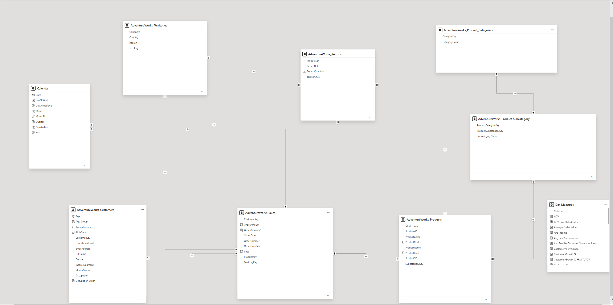
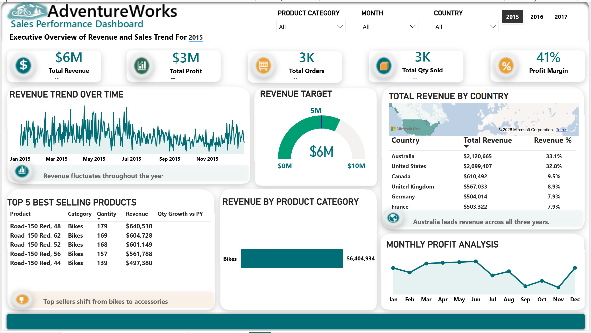
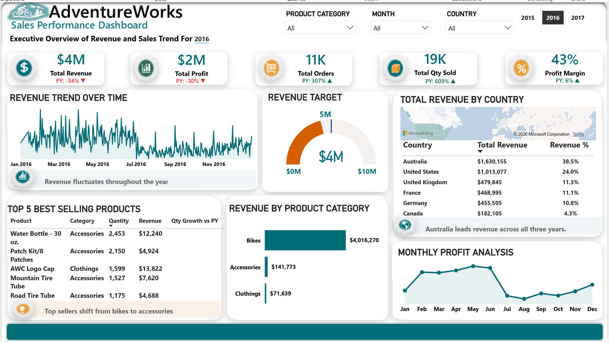
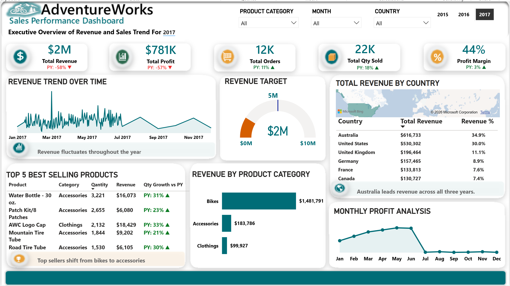
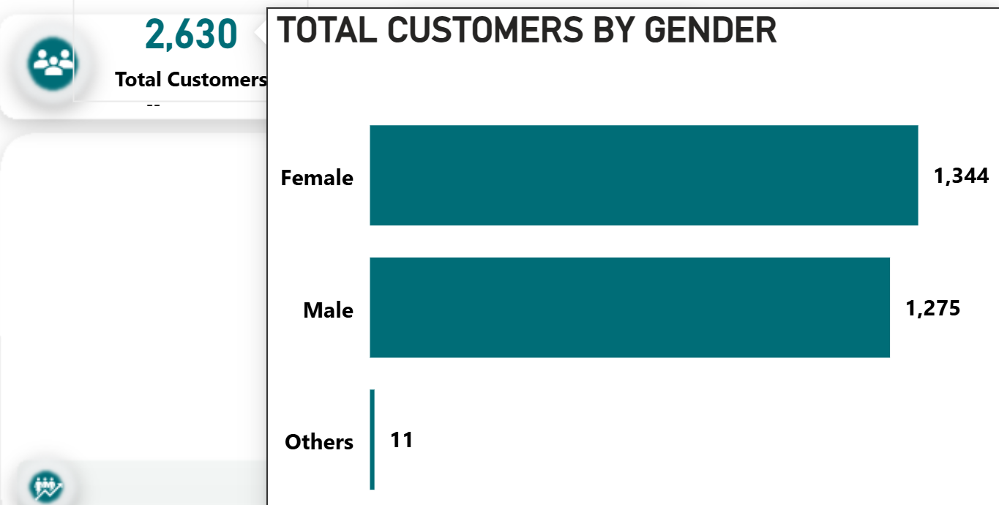
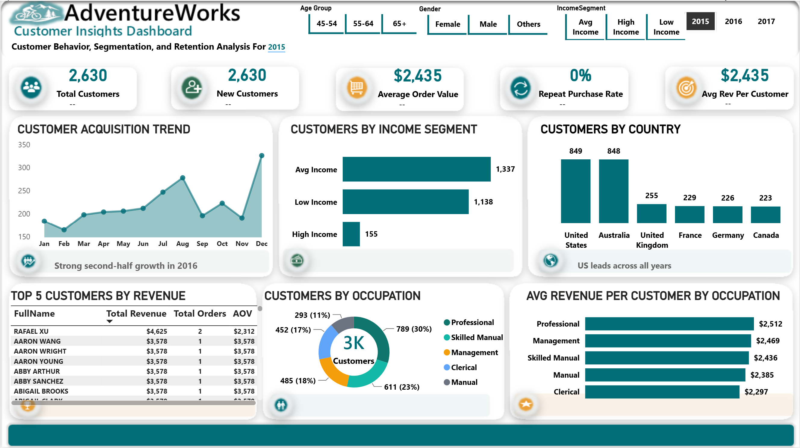
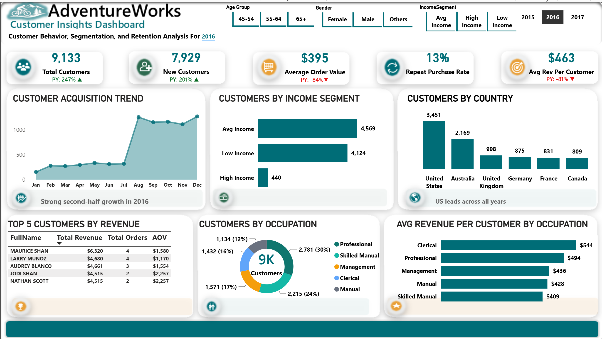
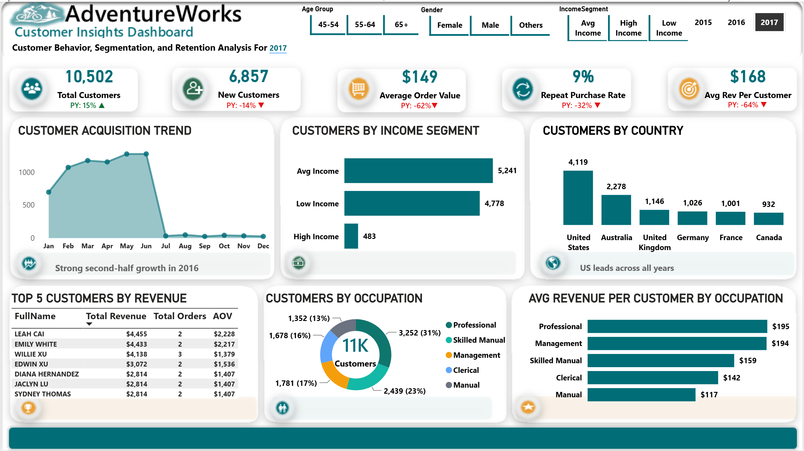

# AdventureWorks_Power_BI_Analysis
### by Darlington Ubuwere
GitHub: [@darlverse](https://github.com/darlverse)
---
An interactive Power BI project exploring AdventureWorks sales performance and AdventureWorks customer insights from 2015 - 2017 through data modeling, DAX, and business intelligence dashboards.

### 1. Project Overview
This project uses the AdventureWorks dataset to develop interactive dashboards that provide insights into sales performance and customer behavior over a three-year period.

**The report consists of two dashboards:**
-	Sales Performance Dashboard: Examines revenue, profit, orders, product performance and geographical sales distribution.
-	Customer Insights Dashboard: Explores customer growth, acquisition, spending patterns, repeat purchases and customer segmentation.

The objective is to demonstrate how data preparation, data modelling, DAX and interactive visualization can transform business data into meaningful insights that support informed decision-making.

### 2. Project Objectives

**The key objectives of this project are to:**

-	Analyze sales and profitability trends across multiple years
-	Monitor key performance indicators (KPIs) and revenue targets
-	Identify top-performing products and product categories
-	Examine geographical sales distribution
-	Evaluate customer acquisition and growth
-	Analyze customer spending and repeat purchase behavior
-	Explore customer demographics and segmentation
-	Present findings through interactive and easy-to-understand dashboards

### 3. Tools and Technologies

The following tools and technologies were used:

-	Microsoft Power BI: Data modelling, DAX calculations and dashboard development
-	Power Query: Data cleaning and transformation
-	DAX (Data Analysis Expressions): Creation of calculated measures and business KPIs
-	GitHub: Project documentation and version control

### 4. Data Preparation

Data preparation was carried out in Power Query before developing the dashboards.

**Key activities included:**

-	Removing duplicate records where necessary
-	Handling missing and incomplete values
-	Correcting data types
-	Removing irrelevant columns based on the analytical requirements
-	Merging relevant tables
-	Creating calculated columns where required

These steps helped prepare the dataset for modelling and analysis.

### 5. Data Model Architecture

The project implements a Hybrid Star-Snowflake Schema, combining elements of both dimensional modelling approaches
The model connects the central sales table with supporting dimensions, including Customers, Products, Calendar, Geography and Returns
The product dimension also incorporates a hierarchical structure through Product Subcategories and Product Categories
This relational design provides the foundation for cross-dimensional analysis, DAX calculations and interactive reporting

### Data Model Overview

### 6. Sales Performance Dashboard
The Sales Performance Dashboard provides an overview of business performance across 2015, 2016 and 2017.

**Key Performance Indicators**
-	Total Revenue
-	Total Profit
-	Total Orders
-	Total Quantity
-	Profit Margin
-	
**Dashboard Features**
-	Revenue Trend Over Time
-	Revenue Target Gauge
-	Total Revenue by Country
-	Top 5 Best-Selling Products
-	Revenue by Product Category
-	Monthly Profit Analysis
  
**Interactive Filters**

-	Product Category
-	Month
-	Country
-	Year

**Dashboard Screenshots**

**Key Findings**
-	Revenue and profit declined across the three-year period, while order volume and quantity sold increased
-	Profit margin increased from approximately 41% in 2015 to 44% in 2017
-	Australia remained the leading revenue-generating country, contributing 33.1% of revenue in 2015, 38.5% in 2016 and 34.9% in 2017
-	Bikes remained the dominant revenue-generating product category throughout the period
-	The top five best-selling products by quantity were exclusively bikes in 2015, while accessories and clothing also appeared among the top five in 2016 and 2017
-	The business exceeded the assumed annual revenue target of $5 million in 2015. The target was held constant at $5 million per year, based on the project instructions

### 7. Customer Insights Dashboard
The Customer Insights Dashboard explores customer growth, acquisition, spending patterns and customer segmentation.

Key Performance Indicators

-	Total Customers
-	New Customers
-	Average Order Value
-	Repeat Purchase Rate
-	Average Revenue per Customer

**Dashboard Features**
-	Customer Acquisition Trend
-	Customers by Income Segment
-	Customers by Country
-	Top 5 Customers by Revenue
-	Customers by Occupation
-	Average Revenue per Customer by Occupation

**Interactive Filters**
-	Age Group
-	Gender
-	Income Segment
-	Year

**Custom Tooltip**

A custom report-page tooltip was connected to the Total Customers KPI to provide an additional breakdown of customers by gender.
This allows users to view the gender distribution on demand without adding more visual elements to the main dashboard.

**Dashboard Screenshots**

**Key Findings**
-	The total customer base expanded considerably between 2015 and 2017.
-	New customer acquisition increased substantially in 2016 but declined in 2017.
-	Average Order Value and Average Revenue per Customer declined across the reporting period.
-	Repeat Purchase Rate improved to 13% in 2016 before declining to 9% in 2017.
-	The United States recorded the highest customer count in 2016 and 2017, while the United States and Australia were nearly tied in 2015.
-	Professional customers represented the largest occupation group throughout the three years.
-	Average-income customers formed the largest income segment, followed by low-income and high-income customers.

### 8. Business Recommendations
Based on the observed dashboard findings, the following areas may warrant further investigation:

1.	Investigate Declining Customer Spending: Examine product mix, pricing and purchasing patterns to better understand the decline in Average Order Value and Average Revenue 		per Customer.
2.	Strengthen Customer Retention: Review customer retention strategies and explore ways to encourage repeat purchases following the decline in Repeat Purchase Rate in 2017.
3.	Review Customer Acquisition Performance: Investigate the decline in new customer acquisition in 2017 and assess the long-term value of newly acquired customers.
4.	Explore Product and Market Opportunities: Strengthen key markets and explore opportunities to encourage complementary purchases across product categories.
5.	Monitor Revenue and Profitability: Investigate the decline in revenue despite increased order volume, while monitoring profit margins and progress against the assumed annual revenue target.

### 9. Data Limitations

The following limitations should be considered when interpreting the findings:

-	The available dataset covers the period from 2015 to 2017 only
-	Daily date-level detail for July to December 2017 is limited, which affects the interpretation of monthly trends during that period
-	The annual revenue target of $5 million was assumed based on the project instructions and should not be interpreted as an officially verified company target
-	The dashboards identify trends and patterns in the available data but do not establish the underlying causes of those trends

### 10. Conclusion

This project demonstrates the use of Power BI to analyze sales performance and customer behavior through interactive dashboards.
The Sales Performance Dashboard provides insights into revenue, profitability, order volume, product categories and geographical performance. The Customer Insights Dashboard explores customer growth, acquisition, spending patterns, repeat purchases and segmentation.
The analysis reveals an expanding customer base and increasing sales volume alongside declining revenue and average customer spending. It also highlights Australia’s contribution to sales, the dominance of the Bikes category and changes in repeat purchase behavior.
Overall, the project demonstrates how data preparation, data modelling, DAX calculations and interactive visualization can be combined to produce meaningful business insights.

### 11. Technical Skills Demonstrated

-	Data cleaning and transformation
-	Data modelling and relationship management
-	DAX measure development
-	KPI development and performance tracking
-	Sales and customer analysis
-	Interactive dashboard design
-	Business insight generation and analytical storytelling
-	Project documentation and version control

### 12. Project Structure

adventureworks_power_bi_dashboard/
│
├── README.md
├── .gitattributes
│
├── Dashboard_Screenshots/
│   ├── Sales/
│   │   ├── sales_dashboard_2015.png
│   │   ├── sales_dashboard_2016.png
│   │   └── sales_dashboard_2017.png
│   │
│   └── Customers/
│       ├── customers_dashboard_2015.png
│       ├── customers_dashboard_2016.png
│       └── customers_dashboard_2017.png
│
└── Documentation/
    └── Data_Model_Overview.png

### 13. Repository Contents
This repository contains the project documentation, dashboard screenshots and data model overview.
The Power BI working file (.pbix), raw datasets and individual DAX formulas have not been included in this public repository.
